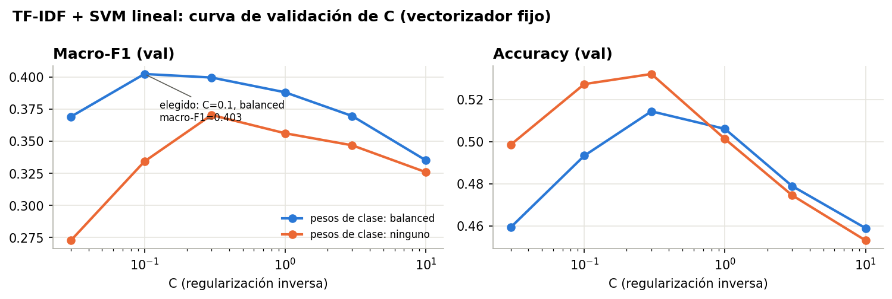

# Análisis temático de proyectos H2020 (CORDIS)

Proyecto final de *Procesamiento de Datos*, Máster en Ingeniería de Telecomunicación (UC3M), curso 2026/27.

**Equipo:** Julia Pérez · Lucía Mora · Lucía Fournier · María Sánchez

> Este README es el **informe** del proyecto. Las instrucciones para reproducirlo están al final.
> _(Las secciones en cursiva son plantillas que hay que completar.)_

---

## 1. Problema y conjunto de datos

Clasificación multiclase de los resúmenes de 35.378 proyectos financiados por H2020 en su
categoría temática EuroSciVoc de **segundo nivel**.

### 1.1. Construcción de la etiqueta

Cada proyecto tiene una lista de términos EuroSciVoc. Para cada término se sube por la jerarquía
(`full_code` en `SciVocCodes.xlsx`) hasta su ancestro de nivel 2. La etiqueta del proyecto es la
del **primer** término de la lista, y el proyecto se descarta si ese término es una raíz. Ver
[docs/decisiones.md](docs/decisiones.md) (D1) para la discusión de la regla.

| | Valor |
|---|---|
| Proyectos iniciales | 35.378 |
| Sin ningún código EuroSciVoc | 3.326 |
| Proyectos con etiqueta válida | **31.951 (90,31 %)** ✔ punto de control |
| Clases de nivel 2 / nivel 1 | 39 / 6 |
| Proyectos con todas sus categorías en una misma clase (nivel 2 / nivel 1) | 32,2 % / 46,9 % |
| Etiquetas que cambiarían con la regla de mayoría (nivel 2 / nivel 1) | 12,1 % / 11,5 % |

### 1.2. Partición

70 / 15 / 15 (train / val / test), estratificada por clase de nivel 2 y agrupada por resumen
(los resúmenes duplicados nunca se reparten entre particiones): **22.366 / 4.792 / 4.793** proyectos.
Fichero fijo: `splits/split.csv`.
Tamaños y clases por partición: `splits/labels.csv`.

### 1.3. Modelo de referencia (baseline)

Clasificador que siempre predice la clase mayoritaria de train (resultados en test):

| Nivel | Clase mayoritaria | Accuracy | Macro-F1 |
|---|---|---|---|
| 2 (39 clases) | biological sciences | 0,108 | 0,005 |
| 1 (6 clases) | natural sciences | 0,391 | 0,094 |

El macro-F1 casi nulo del baseline muestra por qué la accuracy por sí sola no basta con este desbalance.

## 2. Análisis exploratorio

Notebook: [`notebooks/01_eda.ipynb`](notebooks/01_eda.ipynb). Las secciones 2.1–2.3 describen el
conjunto completo. El análisis de texto (2.4) se hace solo con la partición de entrenamiento.

### 2.1. Descripción general

`projects.xlsx` tiene 35.378 filas y 19 columnas: identificadores, texto (`title`, `summary`),
fechas, importes, país coordinador, códigos EuroSciVoc, publicaciones y patentes. También incluye
columnas de la convocatoria que el enunciado no menciona (`topic`, `topic_title`, `masterCall`,
`subCall`, `fundingScheme`). Valores ausentes relevantes:

| Variable | Ausentes | Implicación |
|---|---|---|
| `euroSciVocCode` | 3.326 (9,4 %) | Proyectos sin etiqueta posible: se descartan |
| `publicationID` | 18.166 (51,3 %) | Solo relevante para la extensión de producción científica |
| `patentID` | 34.499 (97,5 %) | Ídem |
| `masterCall` | 20.358 (57,5 %) | No se usa |
| `startDate`, `endDate` | 11 | Solo afecta a la figura por año |

`summary` y `title` no tienen ausentes. `topic` y `topic_title` están muy ligadas a la temática,
por lo que **no se usan como entrada** (ver [decisiones](docs/decisiones.md), D4).

### 2.2. Variable objetivo


* **39 clases con un desbalance fuerte.** La mayor (*biological sciences*, 3.462 proyectos)
  es 385 veces más grande que la menor (*other medical sciences*, 9). Las 5 clases mayores
  suman el 40 % de los proyectos y 7 clases tienen menos de 100.
* **Consecuencia para las métricas:** el macro-F1 da a las clases pequeñas el mismo peso que a
  las grandes, y estas tienen solo 1–5 ejemplos en test. Su F1 por clase será muy ruidoso, así
  que habrá que leerlo junto con el soporte de cada clase.
* **Nivel 1:** *natural sciences* concentra el 39 % y *agricultural sciences* solo el 2 %.


**Modelo de referencia (baseline):**

| Nivel | Clase mayoritaria | Accuracy (test) | Macro-F1 (test) |
|---|---|---|---|
| 2 (39 clases) | biological sciences | 0,108 | 0,005 |
| 1 (6 clases) | natural sciences | 0,391 | 0,094 |

El baseline de nivel 2 acierta el 11 % y su macro-F1 es casi cero. Esto ilustra por qué la
accuracy por sí sola no basta con este desbalance.

**Ambigüedad de la etiqueta.** Cada proyecto tiene de media 2,2 áreas de nivel 2 distintas, y
solo un 32 % pertenece a una única área. En el 68 % restante, la etiqueta es simplemente la
primera de varias áreas igual de válidas. Esto fija un techo de rendimiento por debajo del 100 %.


Además, el notebook muestra que algunas etiquetas son discutibles incluso en su primer término.
Un proyecto sobre fases topológicas en materia condensada, que es física, aparece etiquetado como
*biological sciences*.

### 2.3. Estadísticas básicas


* **Longitud:** la mediana es de 276 palabras y unos 1.960 caracteres. CORDIS limita los
  resúmenes a unos **2.000 caracteres**, y alrededor del 25 % están pegados a ese límite, así
  que probablemente están recortados. Por eso la distribución cae de golpe en torno a 300
  palabras.
* **Implicación para los Transformers:** con este límite, casi ningún resumen supera los 512
  tokens. Truncar es suficiente y no hace falta trocear (hay que comprobarlo con el tokenizador).
* **Anomalías:** 25 resúmenes tienen menos de 30 palabras. Algunos son solo el título o, en un
  caso, solo la palabra «H2020». Se mantienen, pero se documentan.

| | |
|---|---|
|  |  |

* **Proyectos por año:** unos 4.500 al año entre 2015 y 2019, menos en 2020–2021 y una cola en
  2022, que corresponde al final del programa.
* **Países:** hay 57 países coordinadores. Los 5 primeros coordinan el 57 % de los proyectos.

### 2.4. Análisis preliminar del texto (train)


* **Stopwords del dominio.** Los términos más frecuentes (*project*, *new*, *research*,
  *based*, *development*) no dicen nada de la temática. *project* aparece en el 61 % de los
  resúmenes y *new* en el 51 %. Unos 8 términos aparecen en más del 30 % de los documentos, lo
  que justifica usar `max_df` ≈ 0,3–0,5 en TF-IDF.
* **Bigramas frecuentes.** *state art*, *project aims*, *real time*, *climate change* y
  *machine learning* aparecen mucho. Algunos son temáticos, lo que da un argumento para probar
  `ngram_range=(1,2)`.
* **Términos característicos por clase.** Se calculan con χ² frente al resto de clases
  ([tabla completa](results/eda_distinctive_terms.csv)). Las clases grandes tienen un vocabulario
  muy específico: *quantum, physics, universe* en physical sciences; *cancer, patients* en
  clinical medicine; *catalysis* en chemical sciences. Esto anticipa que la bolsa de palabras
  funcionará razonablemente bien. La tabla también revela cosas de la taxonomía:
  * *social geography* es en la práctica «transporte» (*transport, airspace, ATM, SESAR*).
  * *economics and business* está dominada por los servicios a pymes (*SMEs, EEN, KAM*).
  * Las clases pequeñas tienen términos característicos poco fiables, porque salen de muy pocos
    ejemplos. *other medical sciences* (7 en train) mezcla *forensic*, *genocide* y *sperm*.

## 3. Metodología

### 3.1. Preprocesado de texto

Código: [`src/cordis/preprocess.py`](src/cordis/preprocess.py) y
[`scripts/preprocess_text.py`](scripts/preprocess_text.py). Se aplica solo a `summary` y lo usan
TF-IDF y Word2Vec. Los embeddings contextuales usan el texto sin preprocesar.

1. **Tokenización y lematización** con spaCy `en_core_web_sm`. Se desactivan el parser y el NER,
   que no hacen falta. Se lematiza en lugar de hacer stemming porque devuelve palabras reales
   (*networks* → *network*), lo que hace interpretables los términos característicos y los pesos
   del modelo.
2. **Minúsculas.**
3. **Filtrado:** solo tokens alfabéticos (`is_alpha`, que elimina números y puntuación), de 3 o
   más caracteres, sin las 326 stopwords en inglés de spaCy.
4. **La poda por frecuencia de documento** (`min_df`/`max_df`) **no se hace aquí**, sino en el
   vectorizador, porque depende del corpus de entrenamiento.

Como este paso trata cada documento por separado y no aprende nada del corpus, se aplica a todos
los documentos sin riesgo de fuga. Tras el preprocesado, cada resumen tiene una mediana de **163
lemas**. Solo un documento queda vacío: su resumen era únicamente «H2020».

### 3.2. Representaciones

#### TF-IDF

Código: [`src/cordis/features.py`](src/cordis/features.py). Se usa `TfidfVectorizer` de
scikit-learn sobre los lemas, con tf sublineal (1 + log tf), IDF suavizado y normalización ℓ2. El
vocabulario y los pesos IDF se **ajustan solo con train**. Los hiperparámetros (`min_df`,
`max_df`, n-gramas) se eligen en validación junto con el clasificador (§3.4):

| n-gramas | min_df | max_df | vocabulario | macro-F1 val | accuracy val |
|---|---|---|---|---|---|
| **1** | **5** | **0,5** | **16.989** | **0,371** | 0,532 |
| 1 | 5 | 1,0 | 16.992 | 0,370 | 0,533 |
| 1 | 2 | 0,3 | 31.912 | 0,368 | 0,532 |
| 1–2 | 5 | 0,5 | 111.056 | 0,359 | 0,541 |
| 1–2 | 2 | 0,3 | 423.627 | 0,347 | 0,538 |

<sub>Fase 1, con SVM C = 0,3 sin pesos de clase. La tabla completa con 12 configuraciones está en
[results/tfidf_svm_vectorizer_table.csv](results/tfidf_svm_vectorizer_table.csv).</sub>

* **`max_df` apenas influye.** Tras lematizar y quitar stopwords, solo 3 lemas superan el 50 % de
  los documentos y unos 15 superan el 30 %. Además, el IDF ya reduce el peso de los términos
  comunes.
* **Los bigramas suben la accuracy unos +1 punto pero bajan el macro-F1 entre 1 y 2 puntos.**
  El vocabulario pasa de unos 17.000 a 111.000 términos (o a 424.000 con `min_df=2`), y los
  bigramas frecuentes se concentran en las clases grandes. Ojo: la comparación se hizo con C fijo, y la diferencia es del orden del
  ruido en validación (§4), así que no se puede concluir que los bigramas empeoren.
* **Elegido:** unigramas, `min_df=5`, `max_df=0,5`, con 16.989 términos.

#### Word2Vec
_Pendiente (bloque de Lucía Fournier)._

#### Embeddings contextuales
_Pendiente (bloque de María Sánchez)._

### 3.3. Modelos

#### SVM lineal (scikit-learn)

Código: [`scripts/tfidf_svm.py`](scripts/tfidf_svm.py). Se usa `LinearSVC` (uno contra el resto).
Los modelos lineales son la elección natural para TF-IDF, que es disperso y de alta
dimensionalidad (Apéndice A.2).

Primero se probó **regresión logística**, pero no compensaba. Con `lbfgs` tardaba unos 90 s por
ajuste. Con `saga` bajaba a 10 s, pero no convergía en varios minutos al activar
`class_weight="balanced"`, porque los pesos de clase llegan a ~100. Con pesos uniformes daba el
mismo macro-F1 en validación (0,36) que la SVM, que tarda unos 5 s. Por eso se eligió la SVM.



* **Los pesos de clase balanceados son la decisión más influyente.** Suben el macro-F1 en
  validación de 0,356 a 0,403 (+4,7 puntos), a cambio de unos 3 puntos de accuracy en el C
  elegido. Es el comportamiento esperado: penalizan más los errores en las clases pequeñas y así
  se recuperan las minoritarias a costa de equivocarse algo más en las grandes.
* **La regularización óptima es fuerte (C = 0,1).** Con C ≥ 1 el modelo sobreajusta a los
  términos raros de train y las dos métricas caen.
* **Configuración final:** TF-IDF (unigramas, `min_df=5`, `max_df=0,5`) + `LinearSVC(C=0,1,
  class_weight="balanced")`.

#### Red neuronal (PyTorch)
_Pendiente._

#### Transformer con fine-tuning
_Pendiente._

### 3.4. Protocolo de entrenamiento, validación y test

* **Partición fija** de 22.366 / 4.792 / 4.793 proyectos (§1.2), común a todos los modelos.
* **Selección de hiperparámetros:** se entrena con train y se elige el **macro-F1 en
  validación**, que es la métrica principal del problema por el desbalance. Test **no** se usa
  para ninguna decisión.
* **Búsqueda en dos fases**, para que sea asumible en un portátil:
  1. 12 configuraciones del vectorizador con el clasificador fijo.
  2. 12 configuraciones del clasificador (C × pesos de clase) con el mejor vectorizador. Una de
     ellas coincide con la de la fase 1, así que en total son 23 configuraciones distintas.
  * **Limitación:** no explora interacciones como «bigramas + C distinto».
* **Reproducibilidad:** todas las semillas están fijadas (`config.SEED = 42`). Cada configuración
  probada se guarda en `results/*_search_l2.csv`.
* La configuración elegida se reentrena con train y sus predicciones en val y test se guardan en
  `results/preds/`. Las métricas de test se calculan **una sola vez**, en la evaluación
  comparativa (§4), con la misma partición e intervalos de confianza para todos los modelos.

## 4. Resultados
### 4.1. Comparación representaciones × modelos (accuracy, macro-F1, IC)

_Resultados preliminares en **validación** (los de test se calcularán al final, para todos los modelos a la vez):_

| Modelo | Representación | Accuracy val | Macro-F1 val |
|---|---|---|---|
| Clase mayoritaria | — | 0,108 | 0,005 |
| SVM lineal (C=0,1, balanced) | TF-IDF | 0,493 | 0,403 |

### 4.2. Nivel 1 frente a nivel 2
### 4.3. Análisis de errores (confusiones entre hermanas, predicciones en etiquetas descartadas)

## 5. Extensión

## 6. Conclusiones y limitaciones

## 7. Contribuciones y reconocimiento de fuentes

---

## Reproducir los resultados

```bash
pip install -r requirements.txt
# Copiad projects.xlsx y SciVocCodes.xlsx (o H2020.zip) en data/raw/
# o definid CORDIS_DATA_DIR con la carpeta donde estén.
python scripts/build_dataset.py      # etiquetas + comprobaciones (usa splits/split.csv)
python -m pytest -q                  # tests de la lógica de etiquetado
python -m spacy download en_core_web_sm
python scripts/preprocess_text.py    # lematización con spaCy (~10 min, reanudable)
python scripts/tfidf_svm.py          # búsqueda TF-IDF + SVM en val (~6 min, reanudable)
python scripts/plot_tfidf_search.py  # figura y tabla de la búsqueda
```

En código:

```python
import sys; sys.path.insert(0, "src")
from cordis.data import get_splits, load_dataset
(Xtr, ytr), (Xva, yva), (Xte, yte) = get_splits(level=2)   # level=1 para las 6 raíces
df = load_dataset()   # todas las columnas + label_l1/l2, all_l2, n_l2, split
```

Estructura:

```
src/cordis/      código reutilizable (config, data, split, ...)
scripts/         scripts ejecutables
notebooks/       exploración y experimentos (Colab para fine-tuning)
splits/          partición común (se versiona)
results/         métricas en JSON
figures/         figuras usadas en este README
docs/            plan de trabajo y registro de decisiones
data/            datos locales (NO se versiona)
```
